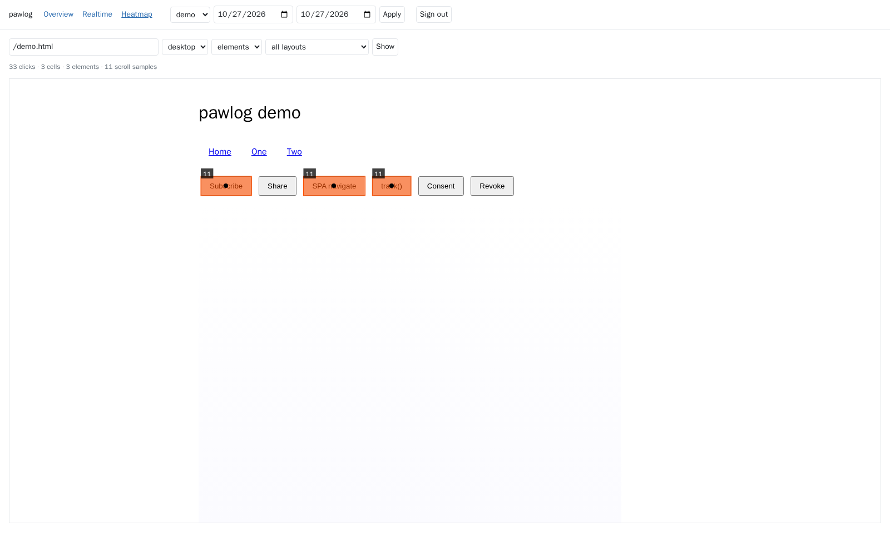

<p align="center"></p>

# pawlog

**Self-hosted, cookieless web analytics with click, element and scroll heatmaps.**

[](LICENSE)


```
pawlog.js ──POST batch──▶ collector (Rust, hyper 1.x) ── validate · bot filter · enrich · hash IP
                              │ JSONEachRow, lz4, acks=all, idempotent
                              ▼
                           Redpanda topic
                              ▼
            ClickHouse: Kafka engine → MV → events (MergeTree, 180-day TTL)
                              │ 7 rollup MVs (AggregatingMergeTree)
                              ▼
                 dashboard (Rails 8): home · reports snapshot · page · realtime overview / pages · heatmap
```

<p align="center"></p>

## Privacy

| | |
|---|---|
| Raw IP | never stored or logged |
| `visitor_id` | sha256(ip, user agent, site, daily salt) → u64; salt random per UTC day, memory only |
| Cookies | none by default; `analytics.consent(true)` sets a first-party id, `consent(false)` removes it |
| DNT / GPC | nothing is sent |
| Bots | crawler list + headless markers dropped at the collector, counted in `/metrics` |

## Quickstart

```bash
cp deploy/.env.example deploy/.env         # every variable is required; edit secrets, origins, sizing
cp deploy/sites.example.yml deploy/sites.yml
make up                                    # redpanda, clickhouse (+migrations), collector, dashboard
```

On each tracked site:

```html
<script defer src="https://<collector>/pawlog.js" data-site="www"
        data-layout="main" data-dashboard="https://<dashboard>"></script>
```

| attribute | |
|---|---|
| `data-site` | site id, also listed in `deploy/sites.yml` |
| `data-layout` | selector of the main layout container; its classes + viewport bucket form `layout_hash` |
| `data-dashboard` | dashboard origin allowed to ask for element positions (heatmap) |

API: `analytics.track(name, props)`, `analytics.consent(true | false)`.

Auto-tracked: pageviews (load, `pushState`, `popstate`), clicks on links/buttons/`[data-track]` (stable selector,
position in element and page), rage clicks (3 in 1 s), max scroll depth, engaged time. Batches flush every 5 s, at
20 events, or on hide, via `sendBeacon` (`fetch` keepalive if the beacon is refused).

## Collector

| method | path | |
|---|---|---|
| POST | `/e` | JSON array of 1–50 events, ≤ 64 KB → `204`; `400` invalid · `403` origin · `413` size · `503` queue full |
| OPTIONS | `/e` | CORS preflight for `ALLOWED_ORIGINS` |
| GET | `/pawlog.js` | tracker, cached 1 day + 1 week stale-while-revalidate |
| GET | `/healthz` | `200` when the broker is reachable and the topic has partitions |
| GET | `/metrics` | Prometheus |

## Load test

`make load` on one host (16 cores; limits: collector 2 CPU, Redpanda 2 CPU, ClickHouse 4 CPU), oha on the compose
network, 20-event batches of 6.7 KB.

| step | duration | RPS | p50 ms | p99 ms | collector p99 ≤ | non-204 | collector CPU avg/max | RAM max | lag max msgs | freshness max s | CH rows/s |
|---|---|---|---|---|---|---|---|---|---|---|---|
| 200/s | 60 s | 200 | 0.13 | 0.40 | 0.25 ms | 0 | 4% / 4% | 9 MiB | 199 | 0.9 | 4,007 |
| 2000/s | 120 s | 2000 | 0.10 | 0.33 | 0.1 ms | 0 | 15% / 24% | 14 MiB | 2,189 | 1.3 | 40,262 |
| 5000/s | 120 s | 5000 | 0.15 | 0.58 | 0.1 ms | 0 | 34% / 45% | 20 MiB | 7,035 | 1.5 | 99,421 |

17,039,860 events sent · 17,039,860 in ClickHouse · 0 dropped · drained 1.1 s after the last request.
CPU % is of one core. Disk (2.4 MiB per 1M events) is a floor: every request carried the same batch, which compresses far
better than real traffic.

## Benchmark

`make bench DAYS=90`: 1M pageviews/day of generated traffic (3.53 events/view, 317.8M events) inserted through the
rollup MVs. ClickHouse limited to 4 CPU / 16 GB.

| store | per day | 180 days | 1 year | 3 years |
|---|---|---|---|---|
| events (TTL 180 d, 46 B/event) | 155 MiB | 27.2 GiB | 27.2 GiB | 27.2 GiB |
| rollups (no TTL) | 36 MiB | 6.4 GiB | 13.0 GiB | 38.8 GiB |
| Redpanda (7-day retention, JSON) | 2.10 GiB | 14.7 GiB | 14.7 GiB | 14.7 GiB |

| page (warm p50, ms) | 7 d | 28 d |
|---|---|---|
| Home | 111 | 412 |
| Reports snapshot | 63 | 124 |
| Page detail | 51 | 52 |
| Heatmap | 7 | 11 |
| Realtime overview (30 min) | 6 | 6 |

| concurrent clients (Home mix, 28 d) | 1 | 4 | 16 | 64 |
|---|---|---|---|---|
| QPS · p50 ms | 12 · 35 | 24 · 99 | 18 · 413 | 14 · 2,589 |

Visitor counts in rollups are `uniqCombined(12)` (fixed ≤ 3 KB state, exact for small sets): 28-day error vs exact
count −0.53% site, −1.01% top page. Ingest 560k–850k events/s per day (average real rate at this volume: 41 events/s).
Slowest query: titles, 412 ms at 28 d.

## Make targets

| | |
|---|---|
| `make up` / `make down` | stack; migrations are idempotent and run on every `up` |
| `make test` | collector (unit + Redpanda), ClickHouse rollups vs raw + EXPLAIN of every query, pawlog.js (Playwright), dashboard |
| `make e2e` | browser → collector → Redpanda → ClickHouse → dashboard heatmap; needs `http://e2e.pawlog.local` in `ALLOWED_ORIGINS` and as a site url in `deploy/sites.yml` |
| `make load` | ramp 200 → 2,000 → 5,000 req/s; `STEPS="200:10 2000:10"` for a short run |
| `make bench` | generated traffic (`DAYS ?= 30`, `VIEWS ?= 1000000`): storage growth, query and page latency, concurrency |

## Layout

| | |
|---|---|
| `collector/` | Rust crate |
| `tracker/` | `pawlog.js` (TypeScript → minified, budget 4 KB gzip) + demo page |
| `clickhouse/` | numbered idempotent migrations, dashboard queries, `migrate.sh`, `test.sh` |
| `deploy/` | compose, `*.example` config (real `.env` / `sites.yml` are gitignored) |
| `loadtest/` | oha driver + sample batch |
| `dashboard/` | Rails 8 app |

## License

[Apache 2.0](LICENSE)
